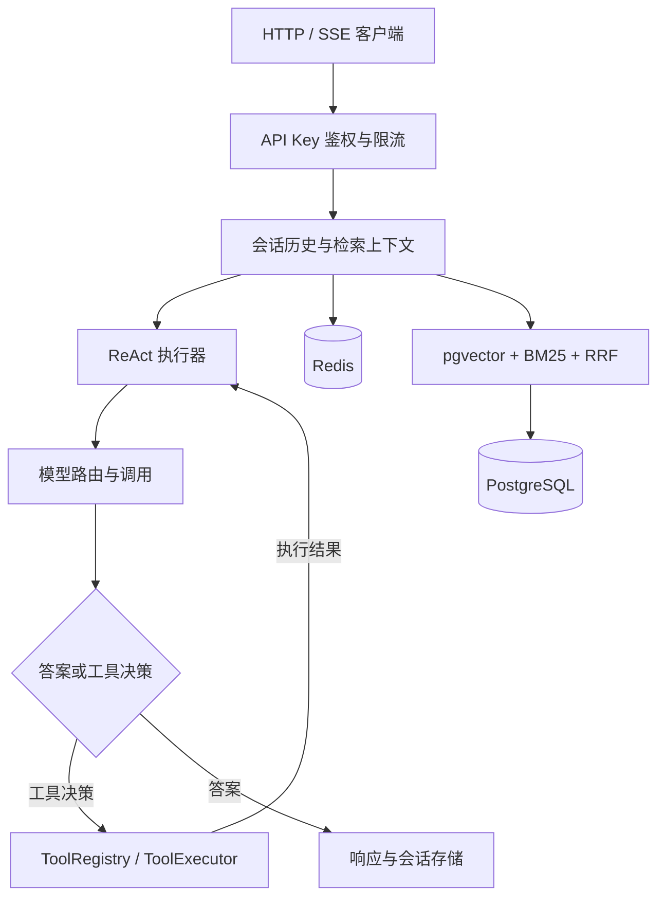

# AgentForge

基于 Java 和 LangChain4j 的智能体服务，提供工具调用、知识库检索、会话记忆和流式响应接口。项目只包含后端，客户端通过 HTTP 或 SSE 调用。

一次请求会先读取会话历史和相关文档，再进入 ReAct 循环：模型给出工具名称与参数，服务执行工具并补充结果，直到生成答案或达到迭代上限。对于需要多个处理方向的问题，也可通过 Supervisor 接口将请求交给匹配的 Worker 并行执行，再汇总结果。

## 功能

| 模块 | 内容 |
| --- | --- |
| ReAct 执行 | 工具决策、结果回填、迭代上限、实际轮数记录 |
| 工具注册 | 扫描 Spring Bean 中的 `@Tool` 方法，按名称调用 |
| 知识库 | 文本分块、嵌入、pgvector 向量检索、BM25 关键词检索、RRF 排序融合 |
| 流式输出 | 会话、状态、工具调用、工具结果、答案片段和完成事件 |
| 多 Worker | 按能力规则路由、专用线程池、异常隔离、共享截止时间、饱和拒绝 |
| 会话记忆 | Redis 保存近期消息，按认证用户与会话隔离，支持过期和长度裁剪 |
| 访问控制 | API Key 注册与撤销、所有者检查、固定窗口限流 |
| 运行观测 | HTTP/JVM 指标、模型调用计数、Token 估算及追踪配置 |

## 技术栈

| 类别 | 组件 |
| --- | --- |
| 运行环境 | Java 21、Spring Boot 3.2、Maven |
| 模型接入 | LangChain4j 0.31、OpenAI 兼容接口、Ollama 聊天模型 |
| 数据存储 | PostgreSQL 16、pgvector、Spring Data JPA、JdbcTemplate |
| 会话与限流 | Redis 7、Lua |
| 观测 | Micrometer、Prometheus、Grafana、Zipkin |

## 请求处理



### 检索

文档先分块并生成嵌入，再将元数据和向量写入同一个 PostgreSQL 事务。查询时分别获得向量和关键词候选，使用 RRF 按排名合并，避免直接比较两种评分的数值。

BM25 从持久化文本读取快照，因此应用重启后仍能检索；嵌入服务不可用时可仅使用关键词结果。删除新摄入的文档时，关联向量和元数据在同一事务内删除。

### 流式响应

`GET /ai/stream` 返回 `text/event-stream`。支持流式的模型通过 SDK 回调返回增量；执行器缓冲工具控制文本，在识别 `Final Answer:` 后转发答案片段。标记允许跨回调到达。不支持流式的模型回退为完整答案返回。

SSE 任务使用独立有界线程池，读取超时或模型失败时不发送成功完成事件。`done` 在会话记忆保存后发送；其中的 Token 数是字符估算。

### Worker 协作

Supervisor 根据 Worker 的 `canHandle()` 规则匹配请求，将原问题交给匹配的 Worker，而后调用模型汇总输出。排队和等待共用截止时间，任务饱和时明确拒绝。取消会请求中断，但不能强制终止不响应中断的底层调用。

## 目录

```text
src/main/java/com/aiagent/
├── auth/             # API Key 管理、鉴权与限流
├── controller/       # 查询、SSE 与知识库接口
├── agent/
│   ├── runtime/      # 上下文组装和 ReAct 执行
│   ├── orchestrator/ # Supervisor 与 Worker
│   └── config/       # 迭代、并发和期限配置
├── llm/              # 模型路由、提示词、流式解析
├── tools/            # 工具发现、分派与实现
├── rag/              # 文档摄入、检索及排序融合
├── memory/           # Redis 会话存储与隔离
├── guardrails/       # 输入规则与输出长度检查
├── observability/    # 日志和指标
└── config/           # 数据与线程池配置

src/test/             # 单元、回归与集成测试
scripts/              # 本地协议桩和联调脚本
docs/                 # 设计及测试说明
```

## 本地运行

需要 JDK 21、Maven 3、Docker Compose，以及可用的聊天和嵌入模型接口。当前嵌入实现使用 `text-embedding-v3`，向量维度为 1024。

### 1. 启动 PostgreSQL 和 Redis

在仓库根目录执行：

```bash
docker compose up -d postgres redis
docker compose exec postgres psql -U postgres -d agentdb -c 'CREATE EXTENSION IF NOT EXISTS vector;'
```

PostgreSQL 默认端口为 `5432`，Redis 为 `6379`。如果本机已有这些服务，可直接复用并调整连接配置，不必另建容器。

### 2. 配置并启动应用

下面以 Bash 为例，按实际提供商填写环境变量。注册令牌用于管理 API Key 的签发，应单独生成和保管。

```bash
export OPENAI_API_KEY='<provider-api-key>'
export OPENAI_BASE_URL='<openai-compatible-base-url>'
export AI_MODEL_ROUTER_SIMPLE_MODEL='<simple-model-name>'
export AI_MODEL_ROUTER_COMPLEX_MODEL='<complex-model-name>'
export AGENTFORGE_REGISTRATION_TOKEN='<registration-token>'

mvn -DskipTests package
java -jar target/ai-agent-template-1.0.0.jar
```

应用默认监听 `8085`，可通过 [健康检查](http://localhost:8085/actuator/health) 确认启动状态。

常用配置如下，完整内容见 [application.yml](src/main/resources/application.yml)：

| 环境变量 | 用途 |
| --- | --- |
| `SPRING_DATASOURCE_URL`、`DB_USERNAME`、`DB_PASSWORD` | PostgreSQL 连接，默认数据库为 `agentdb` |
| `REDIS_HOST`、`REDIS_PORT`、`REDIS_DATABASE` | Redis 地址、端口与逻辑库 |
| `OPENAI_API_KEY`、`OPENAI_BASE_URL` | 聊天和嵌入服务共用的兼容接口配置 |
| `AI_MODEL_ROUTER_SIMPLE_MODEL`、`AI_MODEL_ROUTER_COMPLEX_MODEL` | 按问题长度与关键词选择的模型 |
| `AGENTFORGE_REGISTRATION_TOKEN` | API Key 签发令牌；为空时关闭注册 |

切换到 Ollama 聊天模型时，还需单独考虑嵌入服务；当前嵌入实现不会随聊天 provider 自动切换。

### 3. 签发调用凭证

```bash
curl -sS http://localhost:8085/auth/register \
  -H "X-Registration-Token: $AGENTFORGE_REGISTRATION_TOKEN" \
  -H 'Content-Type: application/json' \
  -d '{"userId":"demo-user","rateLimit":60}'
```

保存响应中的 `key`，后续用它作为 Bearer 凭证。密钥列表不会再次返回该值。

```bash
export AGENTFORGE_API_KEY='<returned-key>'
```

## 使用接口

### 对话与工具调用

```bash
curl -sS http://localhost:8085/ai/query \
  -H "Authorization: Bearer $AGENTFORGE_API_KEY" \
  -H 'Content-Type: application/json' \
  -d '{"query":"计算 2+3*4","sessionId":"demo-session"}'
```

响应包含 `answer`、`sessionId`、`iterationsUsed` 和 `latencyMs`。继续使用同一 `sessionId` 可保留上下文；不同认证用户的同名会话分别存储。

### 流式对话

```bash
curl -N -G http://localhost:8085/ai/stream \
  -H "Authorization: Bearer $AGENTFORGE_API_KEY" \
  --data-urlencode 'query=计算 2+3*4' \
  --data-urlencode 'sessionId=demo-stream'
```

客户端按 SSE 的 `event` 字段处理消息。可能收到 `session`、`status`、`thought`、`tool_call`、`tool_result`、`token`、`done` 或 `error`；工具事件仅在实际调用时出现。

### 摄入与检索文档

准备一份 UTF-8 编码的 `example.txt`，然后上传正文：

```bash
curl -sS 'http://localhost:8085/ai/ingest?filename=example.txt' \
  -H "Authorization: Bearer $AGENTFORGE_API_KEY" \
  -H 'Content-Type: text/plain; charset=utf-8' \
  --data-binary @example.txt

curl -sS -G http://localhost:8085/ai/knowledge/search \
  -H "Authorization: Bearer $AGENTFORGE_API_KEY" \
  --data-urlencode 'query=文档中的问题' \
  --data-urlencode 'topK=5'
```

摄入返回文档 ID、文件名、分块数、UTF-8 字节数和时间。单份文本上限为 1 MiB，`topK` 范围为 1–50。

### 其他接口

| 方法 | 路径 | 作用 |
| --- | --- | --- |
| POST | `/ai/multi-agent/chat?query=...` | Supervisor 调用匹配的 Worker |
| GET | `/ai/knowledge/documents` | 文档列表 |
| DELETE | `/ai/knowledge/documents/{id}` | 删除文档及关联向量 |
| GET | `/auth/keys` | 当前用户的密钥列表 |
| DELETE | `/auth/keys/{id}` | 停用当前用户的密钥 |
| GET | `/actuator/prometheus` | 指标，需要 Bearer 凭证 |

## 测试

先运行不需要外部服务的组件和回归测试：

```bash
mvn -Dtest=AgentForgeE2ETest,StreamingRegressionTest,SupervisorDeadlineTest,AgentExecutionRegressionTest test
```

完整测试还需要 PostgreSQL/pgvector、Redis 和本地模型协议桩。连接信息见 [application-test.yml](src/test/resources/application-test.yml)：测试库为 `agentforge_validation`，Redis 使用 14 号库，协议桩端口为 `18085`。应为这些配置准备独立测试资源，再执行：

```bash
python scripts/validation_model_stub.py
# 保持协议桩运行，在另一个终端执行
mvn test
```

协议桩返回固定答案和向量，用来验证 SDK 调用、事件顺序、失败处理和存储链路，不用于评价模型效果。更多联调步骤见 [测试与设计说明](docs/AgentForge实测验收与可靠性修复.md)。

## 扩展工具

新增 Spring Bean，在接收单个字符串参数的方法上标记 `@Tool`。`ToolRegistry` 启动时扫描注册，运行时自动将工具信息加入提示词。

```java
import dev.langchain4j.agent.tool.Tool;
import org.springframework.stereotype.Component;

@Component
public class GreetingTool {
    @Tool("Return a greeting for the supplied name")
    public String greet(String name) {
        return "Hello, " + name;
    }
}
```

工具方法名应保持唯一。涉及外部系统的工具需自行限定访问权限、超时和返回大小。

## 实现范围

- Supervisor 使用规则路由，没有实现模型自主拆题；DataAnalyst 处理已有算式或 SELECT，不生成自然语言对应的 SQL。
- SQL 执行默认关闭。文件工具默认限制在 `./tool-files`；支付、日志和部分数据库工具仍为演示实现。
- 知识库由已鉴权用户共享，尚未实现文档级租户隔离。BM25 每次读取文本快照，面向小规模文档集。
- API Key 管理接口隐藏密钥，但数据库目前仍保存原始值。限流为首次请求起算的 60 秒固定窗口。
- 当前测试覆盖应用与存储链路；模型回答质量、检索效果和并发性能需要另行评测。
